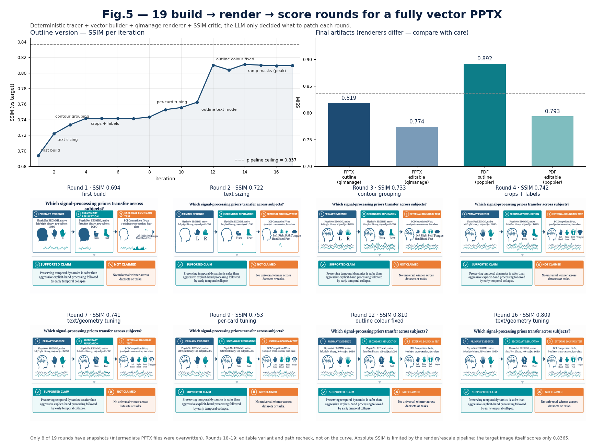
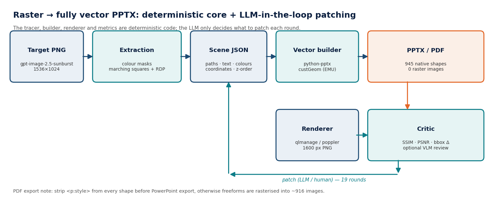

# llm-vector-figure

**Raster → fully vector PPTX: an LLM-in-the-loop case study.**
把一个用 `gpt-image-2.5-sunburst` 生成的论文插图（1536×1024 PNG）自动重建为**全原生矢量 PPTX / PDF** 的实验记录。

> 这不是“让模型画一张图”。轮廓描摹、PPTX 构建、渲染和评分都是确定性代码；LLM 负责诊断问题、调参和决定下一步改什么。本仓库把这条“半自动反馈回路”的代码、数据、19 轮迭代记录和踩坑清单完整公开。

## 结果一览

| 产物 | 说明 | SSIM vs 目标 |
|---|---|---:|
| `outputs/fig5_native_outline_v1.pdf` | **全矢量 PDF**：0 张图片、938 条曲线、161 KB | **0.892**（poppler 渲染） |
| `outputs/fig5_native_outline_v1.pptx` | 945 个原生形状、0 张位图 | 0.819（qlmanage 渲染） |
| `outputs/fig5_native_editable_v1.pptx` | 文字保留为可编辑文本框 | 0.774（qlmanage 渲染） |
| `outputs/fig5_native_editable_v1.pdf` | 全矢量、文字可搜索（518 字符） | 0.794（poppler 渲染） |

**“100% 像素还原”不可达**：把目标 PNG 原样贴进 PPTX、再走同一条渲染链路，SSIM 上限也只有 **0.837**。outline 版已达该天花板的约 **98%**。





## 仓库结构

```
├── README.md                  # 本文件
├── REPORT.md                  # 论文式完整报告（方法 / 案例 / 结果 / 局限）
├── figures/
│   ├── pipeline.png           # 系统架构
│   ├── iteration_history.png  # 19 轮迭代 + 8 张过程快照
│   └── comparison.png         # 目标 / outline / editable 三联对比
├── assets/target.png          # 目标图（gpt-image-2.5-sunburst 生成，保留 C2PA）
├── data/
│   ├── shapes.json            # 图标/波形轮廓
│   ├── text_shapes.json       # 文字轮廓
│   ├── iteration_rounds.csv   # 每轮 SSIM 与改动
│   └── iteration_log.csv
├── code/                      # 提取、构建、渲染评分、闭环脚本
│   ├── extract_shapes.py
│   ├── extract_text.py
│   ├── build_pptx.py
│   ├── render_compare.py
│   └── iterate.py
└── outputs/                   # 最终 PPTX / PDF
```

## 快速开始

```bash
pip install -r code/requirements.txt

# 生成 outline 与 editable 两版 PPTX
python3 code/build_pptx.py
python3 code/build_pptx.py --editable

# 渲染 + 评分（macOS，qlmanage）
python3 code/render_compare.py outputs/fig5_native_outline_v1.pptx

# 自反馈循环（1 轮；--vlm 需要网关 key）
python3 code/iterate.py --mode outline --rounds 1
```

依赖：`python-pptx`、`Pillow`、`numpy`、`matplotlib`、`lxml`、`requests`、`pdfplumber`。
渲染用 macOS 自带 `qlmanage`；PDF 导出用 PowerPoint AppleScript（脚本外步骤，见 `REPORT.md`）。

## 这套东西能复用到什么程度

- **同一版式家族**（论文里的其他卡片式示意图）：10–30 分钟。
- **不同版式的示意图**：1–3 小时，内核照用，重写场景描述。
- **任意图（照片/渐变/3D/复杂图表）**：不建议；描摹会退化成“矢量图片”，不可编辑。

当前代码是“通用内核 + Fig.5 专用外壳”，不是一键通用产品。要通用化，还缺：自动 OCR/文本检测、自动面板检测、参数化 scene spec、auto-patcher。详细判断见 `REPORT.md` 第 4 节。

## 免责声明

- 目标图由 `gpt-image-2.5-sunburst` 生成，文件内保留 C2PA（`trainedAlgorithmicMedia`）元数据。
- 目标图来自一份正在制作中的稿件；本仓库只研究“栅格 → 矢量”的转换方法，不主张原图的科学结论。
- 代码按 MIT 许可；文字与图为 CC BY 4.0。
