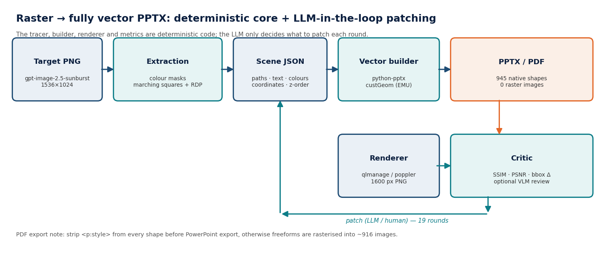
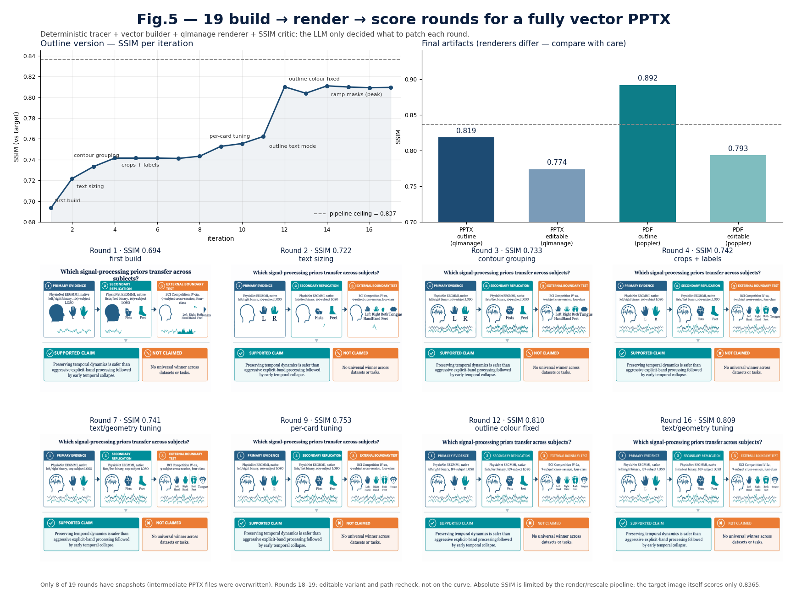

# 从栅格图到全矢量 PPTX：一次 LLM-in-the-loop 的可复现实验

**Raster → Fully Vector PPTX: An LLM-in-the-loop Case Study**

作者：fuguizhao（GitHub: [@zfginucas](https://github.com/zfginucas)）  
日期：2026-11-15  
代码与数据：本仓库

---

## 摘要

本文记录一次把 AI 生成位图（1536×1024 PNG，`gpt-image-2.5-sunburst`）自动重建为**全原生矢量 PPTX / PDF** 的实验。系统由确定性内核（颜色分割、marching-squares 轮廓提取、RDP 简化、`custGeom` 路径写入、Quick Look 渲染、SSIM/bbox 评分）和 LLM-in-the-loop 的修补环节组成。在 19 轮“构建 → 渲染 → 评分 → 修补”后，outline 版本达到 SSIM 0.819（qlmanage 渲染），全矢量 PDF（0 张图片、938 条曲线）达到 0.892（poppler 渲染）。作为对照，把目标图原样嵌入 PPTX 再走同一渲染链路，SSIM 上限只有 0.837——因此“像素级 100% 还原”在该测量链路中不可达，本文报告的重建已达到该天花板的约 98%。

**关键词**：矢量重建、PPTX、OOXML、custGeom、LLM-in-the-loop、SSIM

### English Abstract

We report a reproducible attempt to reconstruct an AI-generated raster figure (1536×1024 PNG, produced with `gpt-image-2.5-sunburst`) as a fully native vector PPTX and PDF. The system couples a deterministic core (colour segmentation, marching-squares contour tracing, RDP simplification, `custGeom` path emission, Quick Look rendering, SSIM/bbox scoring) with an LLM-in-the-loop patching stage. After 19 build→render→score rounds, the outline PPTX reaches SSIM 0.819 under qlmanage, and the fully vector PDF (0 images, 938 curves) reaches 0.892 under poppler. Embedding the target image itself in a PPTX and rendering it through the same pipeline caps at 0.837, so pixel-exact 100% reproduction is not attainable in this measurement setup; our reconstruction reaches about 98% of that ceiling.

---

## 1. 问题

论文插图常常是“位图交付”：审稿系统要求 300 dpi、排版要求不失真、口头报告又希望能改字。理想交付是一个**全原生矢量**、可编辑的 PPTX/PDF。手工重画一张复杂示意图通常需要数小时，而且容易走样。

本文问两个问题：

1. 能否用一条**确定性 + LLM 参与**的流水线，把位图自动重建成全矢量 PPTX？
2. 在这个过程中，LLM 到底做了什么、不能做什么？系统能复用到什么程度？

## 2. 方法

### 2.1 总体架构



系统分为五层：

1. **提取层**：把位图分解为颜色层、轮廓、文字区域；
2. **场景层**：把几何、颜色、z-order、文本写成 JSON（scene spec）；
3. **构建层**：用 `python-pptx` + `a:custGeom` 生成 PPTX；
4. **渲染层**：macOS Quick Look（`qlmanage`）渲染为 PNG；最终 PDF 用 PowerPoint 导出；
5. **评判层**：SSIM/PSNR/MAE、bbox 偏差、分区评分；可选 VLM 评审。

**关键原则**：LLM 不直接写 OOXML。LLM 只修改 scene spec 或生成器参数；PPTX 永远由确定性代码重新生成。这样每一轮可复现、可回滚、可 diff。

### 2.2 轮廓提取

- 对每个颜色层构造“白色 → 目标色”的颜色坡道掩膜；
- 用 marching squares（matplotlib contour）提取闭合轮廓；
- 用 Ramer–Douglas–Peucker 简化（约 0.5–1 px 容差）；
- 用射线法判断轮廓嵌套关系，按“外层 + 孔洞”分组；
- 图标/波形的孔洞用**背景色覆盖层**实现，避免不同渲染器对多子路径填充规则不一致；
- 文字额外做 **4× 超采样**后再描摹，减少小字号 glyph 的锯齿和孔洞误判。

### 2.3 `custGeom` 与单位标定

- 幻灯片尺寸设为 15.36 × 10.24 in，1 个目标像素 = 9144 EMU；
- 每个 freeform 的 `a:path w/h` 必须等于形状 `xfrm/ext`，坐标用 EMU；否则 Quick Look 会把路径坐标按 1 EMU 解释，图形缩成 11 px 的小点（踩坑记录见附录 A）；
- 所有形状在保存前删除从模板继承的 `<p:style>`。

### 2.4 文字：outline 还是 editable

两种策略：

| 策略 | 做法 | 优点 | 缺点 |
|---|---|---|---|
| **outline** | 把 glyph 描摹成矢量轮廓 | 最接近原图；PDF 全矢量 | 文字不可编辑、不可搜索 |
| **editable** | 用 Georgia / Avenir Next 近似，保留文本框 | 可改字、可搜索 | 字体不完全一致，SSIM 较低 |

最终同时交付两版：outline 用于印刷，editable 用于口头报告。

### 2.5 反馈闭环与度量

每轮：

```
build → qlmanage render → SSIM/PSNR/MAE + bbox 偏差 → 人工/LLM 决定修补 → 下一轮
```

度量分三层：

1. **硬规则**：文本 bbox 偏移、越界、重叠、颜色；
2. **像素指标**：全局/分区 SSIM、PSNR、MAE；
3. **VLM 评审**（可选）：gpt-5.4 读取目标图与渲染图，输出结构化 issues。

**重要**：VLM 评审只能当参考。本轮它报告“整体缩小、留白过大”，但像素 bbox 显示各卡片 dx≈0、dy≈0，属于误判。硬约束必须用像素测量。

### 2.6 全矢量 PDF

PPTX → PDF 使用 PowerPoint（AppleScript）。踩坑：如果形状带有继承的 `<p:style>`（`effectRef`），PowerPoint 会把 freeform **逐形状栅格化**——第一版 PDF 里有 916 张图片、2.4 MB。删除全部 `p:style` 后，PDF 变为 **0 张图片、938 条曲线、161 KB**，是真正的全矢量。

## 3. 案例与结果

### 3.1 目标

- 来源：一份制作中的稿件中的 Fig.5；
- 生成模型：`gpt-image-2.5-sunburst`（用户确认；文件内保留 C2PA，`digitalSourceType=trainedAlgorithmicMedia`）；
- 尺寸：1536×1024 PNG。

### 3.2 迭代过程

共 19 次 build → render → score：



关键节点：

| 轮次 | 改动 | SSIM |
|---|---|---:|
| 1 | 第一版：文本框 + 描摹图标 | 0.694 |
| 2 | 字号/颜色标定 | 0.722 |
| 3 | 轮廓分组（外轮廓 + 孔洞） | 0.733 |
| 4 | 裁剪边界、标签、箭头、分隔线 | 0.742 |
| 7–10 | 标题/表头/逐卡片文字微调 | 0.741–0.756 |
| 11 | 文字改成矢量轮廓 | 0.762 |
| 12 | 修轮廓颜色值前缀（`#` 导致填充失效） | **0.810** |
| 13–17 | 掩膜阈值、小孔过滤、标签策略、4× 超采样 | 0.809–0.811 |

只保留了 8 轮的过程快照（中间版本被覆盖），完整逐轮数据见 `data/iteration_rounds.csv`。

### 3.3 结果

| 产物 | 说明 | SSIM |
|---|---|---:|
| **管线天花板**（目标图原样嵌入 PPTX，再走同一渲染链路） | — | **0.8365** |
| outline PPTX | 945 个原生形状、0 张位图 | 0.8186（qlmanage） |
| **outline PDF** | 0 张图片、938 条曲线、161 KB | **0.8918**（poppler） |
| editable PPTX | 文字可编辑 | 0.7740（qlmanage） |
| editable PDF | 全矢量、文字可搜索 | 0.7935（poppler） |

注意：qlmanage 与 poppler 的分数不能直接横比；outline PDF 的 0.892 是在另一渲染器下的测量。

## 4. 讨论

### 4.1 为什么“100% 还原”不可达

把目标 PNG 原样贴进 PPTX，再经 qlmanage 渲染并缩放回 1536×1024，SSIM 只有 0.8365。损失来自渲染器抗锯齿、缩放重采样，以及目标图本身的 AI 噪点与非纯色背景。因此绝对 SSIM 不应被当作“像不像”的唯一标准；更合理的表述是“达到管线天花板的百分比”。

### 4.2 LLM 到底做了什么

- **没有做**：轮廓不是 LLM 画的；PPTX XML 不是 LLM 直接写的；矢量提取是算法。
- **做了**：诊断（为什么 head 变实心、波形不渲染、PDF 被栅格化）、调参（字号/字距/掩膜阈值/裁剪框）、做结构性取舍（outline vs editable）、决定每轮改什么。

所以这是一次 **LLM-in-the-loop** 的迭代，不是“LLM 自主画出矢量图”，也不是无人干预的自迭代系统。

### 4.3 为什么没有 auto-patcher

`iterate.py` 只自动完成 build → render → score，不会自动改参数。真正的闭环还缺：

1. 把布局参数暴露成可优化的 scene spec；
2. LLM/优化器输出 JSON Patch；
3. 白名单 + 边界 + 单轮最大改动量；
4. 分数不升就回滚。

这次最大的两次跃升都是**结构性**的（轮廓分组、文字转轮廓），不是连续参数微调，auto-patcher 发现不了这类改动。

### 4.4 复用性

| 场景 | 工作量 | 说明 |
|---|---|---|
| 同一版式家族 | 10–30 分钟 | 改文本/图标/颜色 |
| 不同版式示意图 | 1–3 小时 | 内核照用，重写场景 |
| 任意图（照片/渐变/3D/复杂图表） | 不建议 | 描摹会退化成不可编辑的“矢量图片” |

当前是“通用内核 + Fig.5 专用外壳”。要产品化，还缺：自动文本检测/OCR、自动面板检测、参数化 spec、auto-patcher、跨平台渲染（LibreOffice headless）。

## 5. 局限

- 目标图是 AI 生成的栅格图，背景有细微噪点，无法逐像素复现；
- outline 文字不可编辑、不可搜索；
- editable 版本的字体是近似（Georgia / Avenir Next），与原图不完全一致；
- 卡片没有复现极淡的投影/渐变；
- 中间迭代版本未存档，19 轮中只有 8 轮有快照；
- VLM 评审可能误判，不能替代像素测量；
- PDF 导出依赖 macOS + PowerPoint；跨平台需替换渲染/导出链路。

## 6. 复现

```bash
pip install -r code/requirements.txt
python3 code/build_pptx.py
python3 code/build_pptx.py --editable
python3 code/render_compare.py outputs/fig5_native_outline_v1.pptx
python3 code/iterate.py --mode outline --rounds 1
```

数据与轮廓已经随仓库提供（`data/*.json`），因此不需要重新跑提取即可复现构建。重新提取：

```bash
python3 code/extract_shapes.py
python3 code/extract_text.py
```

PDF 导出（脚本外）：用 PowerPoint 打开 `outputs/*.pptx`，另存为 PDF；或使用 AppleScript 的 `save as PDF`。导出前确认所有形状的 `<p:style>` 已删除（`build_pptx.py` 会自动处理）。

---

## 附录 A：踩坑清单

1. **custGeom 路径坐标系**：Quick Look 把 `a:path` 坐标按 EMU 解释；`w/h` 必须等于形状 `ext`，否则图形缩成 11 px。
2. **孔洞填充规则**：不同渲染器对多子路径 filling 不一致；稳定方案是“外轮廓填色 + 背景色覆盖层画洞”。
3. **`<p:style>` 导致 PDF 栅格化**：PowerPoint 导出 PDF 时会把带 `effectRef` 的 freeform 转成图片；删除 `p:style` 后恢复全矢量。
4. **颜色值前缀**：`srgbClr val="#0A1A3A"` 无效，必须去掉 `#`。
5. **小孔误判**：文字轮廓内部 <5 px² 的“孔”要用阈值过滤，否则会吃掉笔画。
6. **字体度量**：PIL 量出的字宽与 PowerPoint 实际渲染有 5% 左右差异，必须用渲染回测。
7. **VLM 误判**：它会给出“整体缩放错误”这类与 bbox 矛盾的结论，必须以像素测量为准。

## 附录 B：数据文件

- `data/shapes.json`：图标/波形轮廓（颜色层、轮廓点、bbox）；
- `data/text_shapes.json`：文字轮廓（含孔洞背景色）；
- `data/iteration_rounds.csv`：19 轮 SSIM 与改动说明；
- `data/iteration_log.csv`：闭环脚本写出的评分日志。

---

*本仓库是方法实验记录。目标图由 AI 生成，来自一份制作中的稿件；代码按 MIT 许可，文字与图为 CC BY 4.0。*
